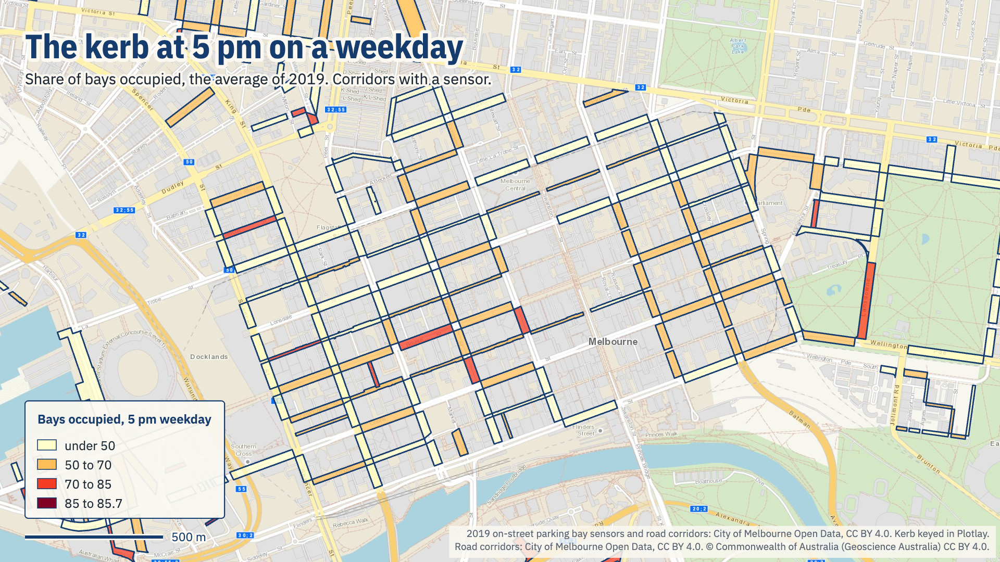
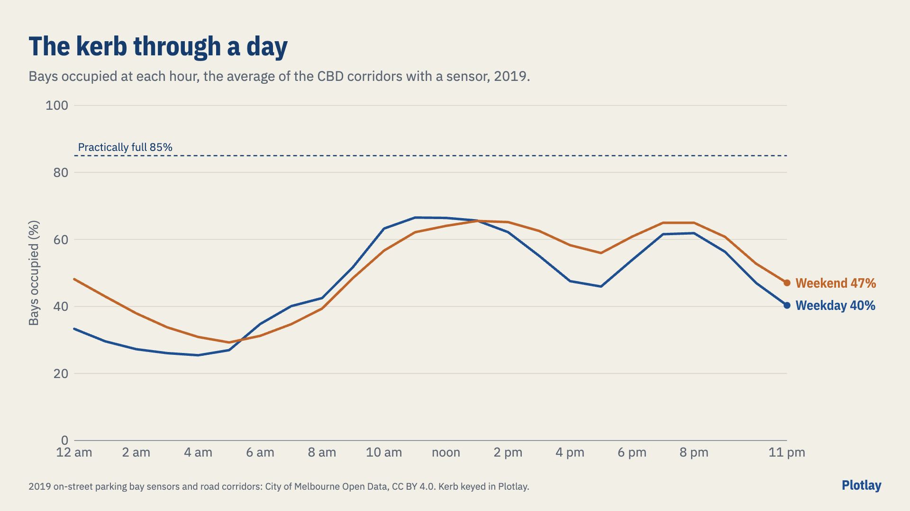

# Kerbside parking through a day

How full the City of Melbourne's kerb was in 2019, hour by hour and street by street, weekdays against weekends, and how long cars stayed. **Live version, with an interactive map:** [getplotlay.com/showcase/melbourne-kerbside](https://www.getplotlay.com/showcase/melbourne-kerbside/)

In 2019 the council's in-ground sensors recorded 42,672,743 arrivals and departures. On the 257 streets matched to a council outline (5,492 bays), **the kerb was 56% occupied between 8 am and 8 pm on weekdays** and 59% at weekends. **A car stayed 59 minutes on average**, and each bay took 10.8 cars a day.

The sensor records name a street and its cross streets but have no outline to map; the council's road corridors are outlines with no parking in them. The shapes here were made in [Plotlay](https://www.getplotlay.com) to join them, and the charts and map pictures were made in Plotlay too.

## What the data says

| | |
|---|---|
| Bays occupied, weekdays 8 am to 8 pm | 56.3% |
| Bays occupied, weekends 8 am to 8 pm | 59.2% |
| Busiest weekday hour | 11 am: 66% |
| Weekday 5 pm, then 7 pm | 46%, then 62% |
| Average stay | 59 minutes |
| Cars a bay a day | 10.8 |
| Stays over the sign's limit | 9% |
| Streets 85% full in at least one weekday hour | 61 of 257 |

- **Fullest** (10 bays or more, weekdays 8 am to 8 pm): Clarendon St, Albert St to Grey St 87%; Queen St, Little Collins St to Collins St 81%.
- **Most cars a bay a day**: Collins St, Queen St to Elizabeth St (half-hour bays), 45 cars, 13 minutes a stay.
- **Longest stays**: Airlie St, Clowes St to The Righi, 217 minutes, a street where residents with permits are exempt from the limit.

### Read it carefully

- 2019, before the pandemic; the sensors have since been replaced and the live feed has no history.
- 5,492 of the 6,625 sensor bays sit on a street matched to a council outline by name.
- How full is read at half past each hour; a bay closed to parking (a clearway, a loading zone in force) reads as empty.
- A stay is a car present 2 minutes to 24 hours; shorter events (27%) are mostly the sensor flickering or a car passing over it; they still count in how full. Public holidays count as weekdays.

## How it was made with Plotlay

1. **Summarise the 2019 file** in Python: each sensor read at half past every hour, added up by street segment and hour, weekdays and weekends apart.
2. **Pick from a layer, Take all.** The council's road corridors that held a sensor: 257 in one step, keyed by `seg_id`.
3. **Link a CSV**, keyed by `seg_id`: each street's summary, and how full at each hour, weekdays and weekends, with the hour as the time axis.
4. **Formula columns**: `full_hours_wd` (`count(occupied_wd >= 85)`), `full_hours_we`, `weekend_vs_weekday`.
5. **Colour** by bays occupied through the day; then by average stay and cars a bay a day.
6. **Charts and map pictures** in the Analysis workspace; the layer exported as GeoJSON, TopoJSON and CSV with WKT.

## What's here

| Folder | What |
|---|---|
| [`data/geometry/`](data/geometry) | The streets from Plotlay (key `seg_id`): GeoJSON, TopoJSON, CSV with WKT |
| [`data/kerb/`](data/kerb) | `kerb_segments.csv` (each street), `kerb_hours.csv` and the weekday and weekend hour tables, `kerb_segments_2019_all.csv` (every kerb segment, matched or not) |
| [`python/`](python) | A narrated notebook: [`kerbside_through_a_day.ipynb`](python/kerbside_through_a_day.ipynb) |
| [`powerbi/`](powerbi) | A Power BI Project (`.pbip`). Start with [`powerbi/OPEN-ME.md`](powerbi/OPEN-ME.md) |
| [`visuals/`](visuals) | The maps and charts |

## Sources and licences

- **Code**: MIT, see [`LICENSE`](LICENSE). **Our data**: CC BY 4.0, see [`LICENSE-DATA`](LICENSE-DATA). Credit "Plotlay (getplotlay.com)" and the sources below.
- On-street Car Parking Sensor Data 2019 and road corridors: City of Melbourne Open Data, data.melbourne.vic.gov.au, CC BY 4.0. Only summaries per street are here, never the event records.
- Base map in the app: © Commonwealth of Australia (Geoscience Australia), CC BY 4.0.

The same city on foot: [plotlay-melbourne-pedestrians](https://github.com/cjmuldoon/plotlay-melbourne-pedestrians). This is independent work using open data, not endorsed by the City of Melbourne. Full credits are in [`NOTICE`](NOTICE).
